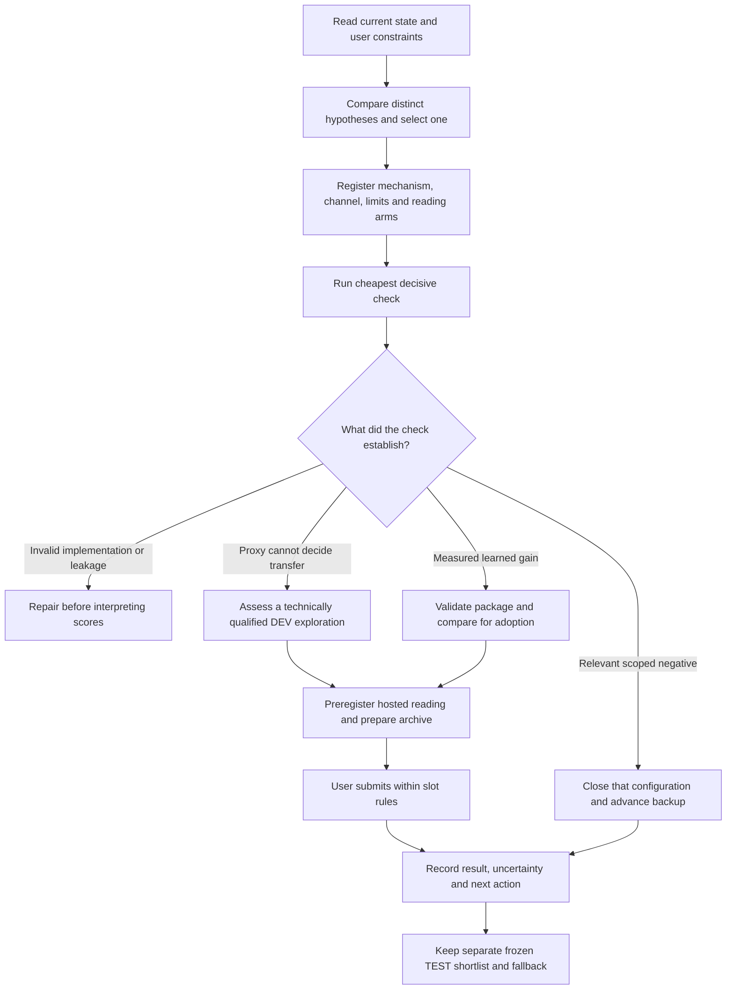

# A015 — Research workflow self-audit and proposed operating flow
date-started: 2026-09-24
date-completed: 2026-09-25
status: done
relates-to: E041 / E052 / E054 / E055 / A011 / A014

Current authority: the user adopted the recommendation in v2 below. The initial
proposal and diagnosis are preserved here; active rules are in CLAUDE.md and
docs/workflow.md, with copy-ready prompts in docs/session-prompts.ko.md.

## Goal and authority

Assess whether the current research process serves the user's objective of
winning TEST, and give a reusable session flow and prompt contract.

This document records findings and a proposed prospective workflow. It does
not replace CLAUDE.md, change an experiment's preregistered decision, promote
a model, authorize hosted upload, or relax technical submission checks.
Existing user authorization for technically qualified exploratory DEV tests
remains in force. Policy changes beyond that authorization require an explicit
prospective decision; do not silently rewrite rules after seeing outcomes.

## Attempt log

### v1 — Evidence audit and workflow proposal

Read CLAUDE.md, current status, newest three log entries, templates, E041
scorecard, A014/E055 outcomes, and the earlier threshold/slot-use corrections.
At audit start status.md had 318 lines despite its one-page handoff purpose.
Consulted primary statistical sources listed below. No model fits or scores
were run; no production/submission files or existing experiment verdicts changed.

### v2 — 2026-09-25: User adoption and operational setup

The user adopted the recommended workflow and authorized efficient session,
instruction-document and subagent organization. The proposal below is retained
as the audit's historical reasoning; active instructions are now in
[workflow.md](../workflow.md), aligned with CLAUDE.md and the future experiment
template. [Session prompts](../session-prompts.ko.md) define S0 coordinator,
S1 research, S2 DEV package/result and S3 TEST finalization. No chat sessions,
background scheduler or persistent custom agents were created.

Independent read-only review identified and helped resolve old rules conflating
archival commits with adoption, universal +.005/proxy-oracle vetoes, and the
sandbox-only restriction despite approved public proxies. All earlier experiment
registrations/verdicts and submission files remain unchanged. New criteria must
be justified before new scores; no retrospective threshold change is permitted.

The shared guide includes bounded main/backup work, evaluated-label exposure,
decision value of probes, separate release/adoption decisions, one integration
owner, ID allocation, resource contention, immutable running sources, result
identity, TEST freeze and precise handoffs. Subagents are optional bounded
workers/reviewers; consensus does not substitute for evidence.

Compacted status.md after preserving its exact pre-setup bytes in
[status-before-workflow.md](A015-outputs/status-before-workflow.md), SHA256
`50a9ae3460605bca51d463246175e5fc64c276ce4f0404acc18096463d01d73e`.
No history deleted. Next session is S0 candidate triage, not automatic E055
reopening or E054 upload. E056 is still available, not a fabricated new candidate.

Final independent review corrected automatic adoption after domain replication,
unsupported expected-score requirements, and wording that would prevent building
the verification tools themselves. Reviewer cleared those corrections. Local
document links, preserved status hash and whitespace checks passed. No model
tests were needed for these instruction/document-only changes.

## Diagnosis

The objective is coherent; execution and decision-making need different fixes.
No numerical self-rating or estimate of win probability is supported.

| Area | Evidence | Assessment and correction |
| --- | --- | --- |
| Reproducibility | E055 frozen predictions, hashes, independent optimum reconstruction and exact renderer parity | Strong. Retain source/data boundaries and concise reproducible records. |
| Deployment protection | E041 source/archive parity and official three-schema checks; A012 phase-2 rehearsal | Strong. Keep mandatory technical gates and a frozen fallback. |
| Transfer judgment | E041 failed local performance qualification but became reported DEV best, .63 to .64 | Local rejection cannot universally veto hosted exploration. This is one counterexample, not proof external validation is useless. |
| Threshold calibration | +.005 came from 10 old sandbox split scores, mean SD about .0016; reused in E055 | It is an operational adoption bar, not a universal significance level, paired-difference interval, or SIPP/TEST futility bound. |
| Diagnostic interpretation | A011 measured mismatch; E055 measured a small finite-family proxy maximum | Neither establishes the cause of the plateau or recoverable target gain. Label mechanism findings separately from measured improvement. |
| Decision continuity | User had to challenge both slot withholding and threshold interpretation; corrections remain scattered | Assistant should surface conflicting rules and counterevidence before making a recommendation. |
| Handoff usability | status.md grew to 318 lines, with details repeated across records | Keep current decision and next action in a short summary; retain historical details in linked append-only records. This audit does not perform that separate reorganization. |
| Work allocation | Several recent analyses ended without an improvement candidate | Track whether each diagnostic changes a decision. Do not treat number of analyses, test passes or ZIPs as competitive progress. No measured time-allocation claim is available. |

Responsibility: the assistant imported the existing +.005 adoption bar into an
external proxy continuation gate and treated the resulting STOP too strongly
in recommendations. The user should not need to discover this mismatch by
repeatedly questioning the assistant. Conversely, following a negative result
with an unregistered lower cutoff would create a different error. Preserve
E055's original STOP and scope; evaluate any new policy prospectively.

## Three operating options

1. Submission-first: quick mechanism changes and frequent hosted readings.
   Advantage: target contact. Cost: noisy readings and shallow attribution.
2. Validation-first: require strong local proof before every hosted test.
   Advantage: fewer weak packages. Cost: proxy mismatch can filter out E041-like
   candidates; more precise proxy measurement does not prove transfer.
3. Recommended: bounded local research plus separately qualified DEV exploration,
   with stricter evidence for final TEST selection. Technical validity is always
   mandatory; research priority, exploratory submission and adoption are distinct.

This recommendation is a decision under uncertainty, not a proven optimal
policy. Do not invent probabilities of winning or mathematically optimal slot
allocations from the available evidence.

## Proposed session flow

At session start, summarize incumbent, latest result, slot status, available
compute/time, target phase and the one decision this session should resolve.
Infer unchanged preferences from records; ask only for missing consequential
constraints. A normal start prompt should not require the user to repeat rules.

Compare a small bounded set of materially different hypotheses, with one main
task and one independent backup. Three hypotheses is a convenient default,
not a scientific threshold or a quota for inventing weak ideas. Keep each card
to mechanism, target cells, supporting/contradicting evidence, cheapest test,
transfer limits, cost cap, and decision that each outcome changes.

Use an oracle before estimator construction as required by current rules.
State its data, frozen components, parameter family and empirical versus
population scope. If a channel does not exercise the mechanism, label it
uninformative for that claim. Do not fabricate a simulator to obtain a pass.
Where current rules prevent proceeding, explain that rule and the proposed
prospective exception; do not disguise an exception as statistical evidence.

Separate fit, calibration, selection and final audit roles before scoring.
Repeated model selection on the same audit rows makes them development data.
Report paired deltas and dependence-aware uncertainty when estimable; identify
what uncertainty is omitted. No required p-value, invented confidence interval,
or cross-population conversion to a hosted score.

Stop a task at its registered gate or resource cap. If authorized time remains,
continue the already justified backup rather than ending with only "next step".
Do not start endless new studies, spend the hosted slot automatically, or run
additional seeds merely to rescue the current result.

## Outcome-specific decisions

| Observation | Valid inference | Next action |
| --- | --- | --- |
| Leakage, invalid probabilities, parity failure, checker failure or budget violation | Candidate not technically qualified | Fix and rerun affected checks; do not interpret failure as model inferiority. |
| Tiny exact oracle gain on a fixed proxy family | Small empirical headroom for that sample/family | Honor its preregistered STOP; lower priority. It does not close all target-domain variants. |
| Mechanism absent or source mismatched | Channel cannot answer the target question | Record limited scope; consider a distinct channel or separately authorized exploratory design. |
| Positive learned held-out gain | Evidence for improvement on that channel | Check transfer mechanism, regression and runtime; qualify package. No automatic TEST promotion. |
| Weak proxy results but a concrete target mechanism | Transfer remains uncertain | Under existing exploration authorization, compare a qualified UNHCR-only DEV test against alternatives; no arbitrary daily coefficient sweep. |
| Grand unchanged, no best update | No readable new best; instrument scores unavailable | Apply registered arm; do not fill hidden values or declare exact zero. Repetition needs a prior reading rationale. |
| Grand increases | Favorable target observation, still rounded/noised | Preserve exact artifact, inspect available controls, update DEV incumbent as justified; qualify separately for TEST. |
| All likely probe outcomes leave the next action unchanged | Low decision value under available resolution | Prefer another qualified candidate; otherwise explain why no useful submission was prepared. |
| No qualified candidate within the session budget | Delivery incomplete, not proof the family is impossible | Report concrete blocker and smallest next test. Continue an authorized ready backup if feasible. |

All submissions still need clean no-regression under the existing tolerance,
source/assembled parity, ZIP checker and official score.py PASS on all three
schemas, plus preregistered SCORES.md. Measurement tests affect UNHCR only unless
a separately specified design changes the existing authorized scope. Keep the
dated submissions layout and user-controlled upload.

## DEV and TEST decisions

DEV is a research channel and an incumbent record. TEST is a single final
selection. A noisy best DEV reading alone cannot validate the TEST choice.
For each serious finalist retain target evidence, generalization limitations,
activation conditions, changes when TRAIN+DEV becomes visible, probability
calibration, runtime/memory observations, phase-2 parity and the fallback.
Freeze final selection criteria and an engineering cutoff before the final
choice; verify current official dates then. Do not infer winning score or
future competitors' performance from the existing .65 screenshot.

Prefer an eligible, decision-relevant prepared submission over an unused DEV
slot, consistent with the user's preference. Neither "submit anything daily"
nor "wait for proxy certainty" is a universal rule. If a slot is left unused,
identify the missing qualification or the absence of a distinguishable reading.

## User and assistant contract

The user supplies goal/priority, changed time or compute constraints, intended
submission date, and actual hosted results. The assistant owns record retrieval,
hypothesis comparison, uncertainty, implementation/validation, result recording,
artifact preparation, bounded continuation and Git synchronization.

Session report, in this order:

1. Decision and recommendation.
2. Measured evidence and comparison baseline.
3. What remains unknown and what was not tested.
4. Exact stop/continue reason: technical, scoped evidence, resource or policy.
5. Submission readiness, path, next executable action and completed Git status.

If a prior recommendation was wrong, identify the old claim and new evidence,
then record the correction. Do not merely switch to the user's latest framing.
Keep facts, interpretations and policy judgments explicit.

## Reusable prompts

### Start or resume

"Resume from CLAUDE.md, status.md and the latest three log entries. Optimize
for TEST competitiveness while using DEV for informative exploration. This
session's time/compute constraint is [constraint]; intended submission is [date
or none]. Compare distinct hypotheses, choose a main task and backup, and state
what each test can establish. Separate technical qualification, exploratory
submission and adoption. Run authorized work within the budget; when a branch
stops, execute a justified ready backup if time remains. Report the result,
limitations, submission readiness and next action. Preserve historical verdicts."

The brackets are user inputs, not unresolved research tasks. If omitted, use
known preferences and a bounded session; do not promise an unbounded run.

### Receive a result

"E0XX returned Grand X with/without a best update. Visible instrument scores
are [values or unavailable]; the platform status is [status]. Record the actual
reading against its preregistered arms, state what it does and does not tell us,
update incumbent/TEST implications, and continue the next justified local task.
Do not invent hidden scores or upload another submission."

### Challenge or review strategy

"Audit the current decision. Separate measured facts, assumptions and operating
rules. Show counterevidence, the population/family covered by the stopping rule,
and what observation would change your recommendation. Propose any rule change
prospectively; retain the original experiment record."

## Sources and limits

- [E041 scorecard](../../submissions/2026-09-19-E041/SCORES.md): local qualification
  failed, reported hosted best improved; a transfer counterexample with noisy
  target evidence, not proof of a particular causal mechanism.
- [E055](../experiments/E055-coupled-star-replay.md) and its independent review:
  both registered finite proxy maxima STOP; not a hidden-survey bound.
- [CLAUDE.md](../../CLAUDE.md), log entry 2026-08-12 and slot-use correction:
  threshold origin and existing exploration authorization.
- [ASA statement](https://www.amstat.org/asa/files/pdfs/p-valuestatement.pdf):
  statistical significance and effect importance are different; a threshold
  alone does not replace contextual reasoning. Our +.005 is an effect-size
  policy, not a p-value; this source does not choose its replacement.
- [Cawley and Talbot, 2010](https://www.jmlr.org/papers/v11/cawley10a.html): finite
  validation-based model selection can overfit the selection criterion. This
  supports preserving evaluation boundaries, not a particular split fraction.

## Feeds into

Next-session decision framing and a proposed prospective operating policy.
No new experiment ID, model, score claim, test run or submission produced.
E041 remains incumbent; E055's registered STOP and E054's parked status remain.
